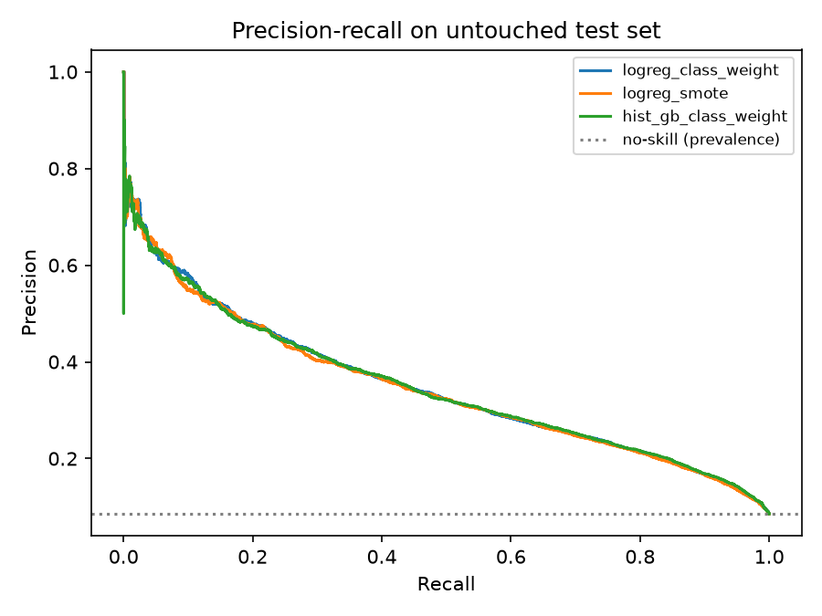

# Heart disease risk: an honest evaluation

Predicting self-reported heart disease from survey answers (CDC BRFSS 2020,
319,795 respondents, 8.6% positive), with the evaluation done correctly.

## Why this repo exists

This is a rebuild of a project from my M.Sc. in Data Analytics (National
College of Ireland, 2022). The original notebook reported **90.6% test
accuracy**. Looking at it again, that number was inflated by data leakage:

- Scaling and SMOTE were applied to the **whole** dataset, and only then was
  it split into train and test.
- Synthetic rows built from training neighbours ended up in the test set, and
  the test set was artificially 50/50 instead of the real 8.6% positive rate.
- Accuracy was the headline metric, which hides failure on a rare class: a
  model that always says "no disease" scores about 91%.

This repo fixes the evaluation and quantifies how much the mistake mattered.

## Leakage demo

Same model (an unpruned decision tree), only the order of operations changed
(`src/leakage_demo.py`):

| | Test positive rate | Recall | F1 | PR-AUC |
|---|---|---|---|---|
| SMOTE before split (original mistake) | 50.0% | 0.90 | 0.90 | 0.856 |
| Split first, SMOTE inside pipeline | 8.6% | 0.30 | 0.25 | 0.126 |

## Results (untouched test set, natural class balance)

Method: stratified 80/20 split first; preprocessing and imbalance handling
inside a pipeline; decision threshold picked from 5-fold out-of-fold
predictions on the training data to reach about 80% recall, then applied once
to the test set (63,959 rows, 5,475 positives).

| Model | PR-AUC | ROC-AUC | Recall | Precision |
|---|---|---|---|---|
| Majority-class baseline | 0.086 | 0.500 | n/a | n/a |
| Logistic regression, class weights | 0.348 | 0.837 | 0.80 | 0.22 |
| Logistic regression + SMOTE | 0.346 | 0.835 | 0.80 | 0.21 |
| Gradient boosting, class weights | 0.348 | 0.839 | 0.80 | 0.22 |



### What the numbers say

- **Real signal, modest ceiling.** PR-AUC of about 0.35 is roughly 4x the
  no-skill level (0.086), but far from the 0.856 the leaky setup suggested.
- **At 80% recall, precision is about 22%**: roughly 3.5 false alarms for every
  true case caught. That is acceptable for a cheap first-pass screen and poor
  for anything that triggers an expensive follow-up.
- **Model choice barely matters here.** A plain logistic regression matches
  gradient boosting, and SMOTE adds nothing over simple class weights. The
  limit is the information in the features, not the algorithm.

## Limitations

- Labels are self-reported survey answers, not clinical diagnoses.
- No probability calibration or subgroup (age, sex, race) error analysis yet.
- The baseline's "recall 1.0" row is an artefact of the threshold rule (it
  flags everyone), so it is excluded from the recall/precision columns.
- This is a learning project, not a medical tool.

## Run it

```bash
pip install -r requirements.txt
# download heart_2020_cleaned.csv into data/ (see data/README.md)
python src/leakage_demo.py
python src/train.py
pytest
```

## Layout

```
src/common.py         load data, stratified split, preprocessing
src/train.py          models, threshold selection, metrics, PR curves
src/leakage_demo.py   original mistake vs correct order, side by side
tests/                guards against re-introducing the leakage
results/              metrics.json, leakage_demo.json, pr_curves.png
```
